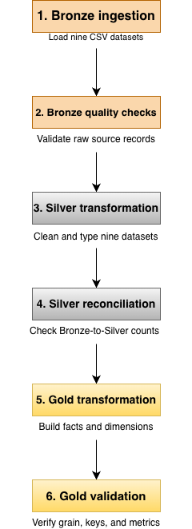
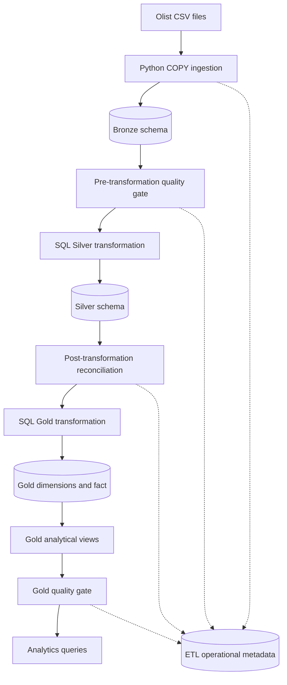

# Olist E-commerce ELT Pipeline

An end-to-end data engineering project that transforms the
Olist Brazilian E-Commerce dataset from raw CSV files into
analytics-ready PostgreSQL tables and views.

The project demonstrates Python-based ingestion, SQL
transformations, dimensional modeling, automated data quality,
pipeline orchestration, testing, and operational observability.

## Tech Stack

- Python 3.9
- PostgreSQL
- psycopg 3
- SQL
- pytest
- VS Code
- Git

## Architecture



Pipeline execution history, step status, ingestion batches,
and quality results are recorded in the `etl` schema.

## Data Source

Olist Brazilian E-Commerce Public Dataset:

https://www.kaggle.com/datasets/olistbr/brazilian-ecommerce

The dataset contains nine source CSV files describing
customers, orders, items, products, sellers, payments,
reviews, geolocation, and category translations.

## Data Layers

### Bronze

Nine raw tables preserve source values primarily as text,
with ingestion metadata such as batch ID, source filename,
and ingestion timestamp.

### Silver

Nine typed tables apply data type conversion, primary keys,
foreign keys, and validation constraints.

### Gold

Three dimensions:

- `gold.dim_customers`
- `gold.dim_products`
- `gold.dim_sellers`

One fact table:

- `gold.fact_order_items`

Five analytical views:

- `gold.vw_order_metrics`
- `gold.vw_monthly_sales`
- `gold.vw_category_performance`
- `gold.vw_state_performance`
- `gold.vw_customer_purchase_summary`

The fact table grain is one order item, identified by
`(order_id, order_item_id)`.

## Pipeline Steps

1. Bronze ingestion
2. Pre-transformation quality validation
3. Silver transformation
4. Post-transformation reconciliation
5. Gold transformation
6. Gold analytical view creation
7. Gold validation

The pipeline stops when a required step fails.

## Local Setup

### Prerequisites

- Python 3.9-compatible environment
- PostgreSQL installed and running
- PostgreSQL `psql` command available
- Olist CSV files downloaded separately

### 1. Create a virtual environment

```bash
python3 -m venv .project1
source .project1/bin/activate
```

### 2. Install dependencies

```bash
python -m pip install -r requirements.txt
```

### 3. Configure the database

Create a local PostgreSQL database named `ecommerce_dw`.

Copy the environment template:

```bash
cp .env.example .env
```

Edit `.env` with your local PostgreSQL credentials.

Never commit `.env`.

### 4. Place the source data

Place the nine Olist CSV files into:

```text
data/raw/
```

Extract the nine Olist CSV files into:

```text
data/extracted/
```

### 5. Initialize the database

Run the schema setup scripts in dependency order.

Refer to [Runbook](docs/runbook.md) for the exact
initialization commands.

### 6. Execute the pipeline

```bash
python src/05-run_pipeline.py
```

### 7. Run automated tests

Unit tests:

```bash
python -m pytest -v
```

Read-only PostgreSQL integration tests:

```bash
RUN_DB_TESTS=1 python -m pytest -v
```

## Data Quality

The project includes checks for:

- Missing customer identifiers
- Duplicate order identifiers
- Invalid order-item prices
- Invalid review scores
- Orphaned order items
- Bronze/Silver count reconciliation
- Gold fact count and grain
- Gold dimension coverage
- Gold analytical metric reconciliation

Quality results are stored in the `etl` schema.

## Observability

Operational metadata includes:

- `etl.ingestion_batches`
- `etl.data_quality_runs`
- `etl.data_quality_results`
- `etl.rejected_records`
- `etl.pipeline_runs`
- `etl.pipeline_step_runs`

The pipeline records status, timestamps, step duration,
exit codes, and error messages.

## Analytical Use Cases

The Gold views support:

- Monthly delivered merchandise value
- Average order value
- Category performance
- Customer-state performance
- Repeat customer analysis

Merchandise value is based on order-item prices.
It is not equivalent to recognized accounting revenue.

## Design Decisions

- Full-refresh processing for a static dataset
- ELT transformations performed in PostgreSQL
- Bronze/Silver/Gold layered architecture
- Dimensional Gold model with order-item grain
- Fail-fast orchestration
- Database-backed operational metadata

## Known Limitations

- No incremental ingestion or CDC
- No scheduling service
- No automatic retry policy
- No centralized monitoring or alerting
- No end-to-end transaction across all pipeline stages
- No Slowly Changing Dimension Type 2 history
- Local deployment only

## Additional Documentation

- [Architecture and design decisions](docs/architecture.md)
- [Operational runbook](docs/runbook.md)
- [Portfolio walkthrough](docs/portfolio.md)
```

**Important:** The setup section above is not yet a complete fresh-machine installation procedure. In the next steps we'll document the actual schema initialization order and verify it against your files.

## 4. Create `docs/architecture.md`

In VS Code, right-click the project root, create a folder named `docs`, then create:

`docs/architecture.md`

### Concept: logical versus physical architecture

A **logical architecture** explains the system's components and their relationships.

A **physical architecture** explains where those components run.

For your project:

- Logical: CSV → Bronze → Silver → Gold → analytics.
- Physical: local CSV files, Python scripts, and PostgreSQL on your Mac.

We'll document both without implying the project is already deployed to the cloud.

Paste:

<CodeBlock language="markdown" editable>
# Architecture and Design Decisions

## 1. System Overview

The Olist ELT pipeline processes nine source CSV files
into PostgreSQL Bronze, Silver, and Gold schemas.

The pipeline is orchestrated by Python and uses SQL
for data transformations.

## 2. Logical Architecture



## 3. Physical Architecture

The current implementation runs locally:

- CSV files: `data/raw/`
- Python: virtual environment `.project1`
- Database: local PostgreSQL `ecommerce_dw`
- Transformations: SQL scripts in `sql/`
- Orchestration: `src/run_pipeline.py`
- Tests: `tests/`
- Logs: `logs/`

No cloud infrastructure or external scheduler is required.

## 4. Bronze Layer

Purpose: preserve source data and ingestion lineage.

Characteristics:

- Nine source-aligned tables
- Raw values stored primarily as TEXT
- Batch ID, source file, ingestion timestamp
- Full-refresh ingestion using PostgreSQL COPY

Why COPY?

It provides efficient bulk ingestion compared with
executing one INSERT statement per source row.

## 5. Silver Layer

Purpose: create typed and relationally consistent data.

Characteristics:

- Nine tables
- Appropriate numeric, timestamp, and text types
- Primary and foreign keys
- Domain validation constraints
- Transactional full-refresh SQL transformation

Data quality gates verify source validity and
Bronze/Silver reconciliation.

## 6. Gold Layer

Purpose: provide analytics-ready dimensional structures.

### Dimensions

- `gold.dim_customers`
- `gold.dim_products`
- `gold.dim_sellers`

### Fact

- `gold.fact_order_items`

Grain: one row per `(order_id, order_item_id)`.

Measures:

- `item_price`
- `freight_value`

The fact table references dimensions through surrogate keys.

### Analytical Views

- Order metrics
- Monthly delivered sales
- Product category performance
- Customer-state performance
- Customer purchase summaries

## 7. Modeling Decisions

### Why an order-item fact?

It preserves product and seller detail while supporting
aggregation to orders, categories, customers, and months.

### Why separate order-level metrics?

Joining raw order items directly to multiple payment rows
can multiply records and inflate measures.

Order metrics are aggregated at the correct grain before
being used in higher-level analytics.

### Why distinguish customer IDs?

`customer_id` identifies a customer record associated
with an order. `customer_unique_id` supports grouping
purchases by the underlying customer identity.

### Why filter delivered orders in sales views?

The reporting definition focuses on delivered merchandise.
It should not be interpreted as recognized accounting revenue.

## 8. Orchestration

Seven sequential steps are controlled by Python.

Each step runs as a subprocess.

A nonzero exit code stops the pipeline.

Execution metadata is stored in:

- `etl.pipeline_runs`
- `etl.pipeline_step_runs`

Ingestion and quality checks maintain separate audit records.

## 9. Transaction Boundaries

Silver transformation is transactional.

Gold transformation is transactional.

The complete seven-step pipeline is not one database
transaction. A failure after Silver commits does not
automatically roll Silver back.

This is a known limitation.

## 10. Idempotency

Full-refresh transformations replace business records
rather than append duplicates.

Repeated successful executions preserve expected
business-record counts.

Generated surrogate keys and operational metadata
may change between runs.

## 11. Trade-offs

### Full refresh versus incremental processing

Chosen: full refresh.

Reason: static, manageable local dataset.

Trade-off: unnecessary processing for unchanged rows.

Alternative: watermark-based incremental loading or CDC.

### PostgreSQL SQL versus Spark

Chosen: PostgreSQL SQL.

Reason: data volume is manageable in a single database,
and SQL provides transparent transformations.

Alternative: Spark for larger distributed workloads.

### Python orchestration versus Airflow

Chosen: Python subprocess orchestration.

Reason: low infrastructure overhead and direct visibility
into step sequencing.

Alternative: Airflow for scheduling, retries, task history,
dependencies, and alerting.

### Standard views versus materialized views

Chosen: standard views.

Reason: simple maintenance and always query current
underlying Gold tables.

Trade-off: aggregations are recomputed at query time.

Alternative: materialized views with a refresh strategy.

## 12. Known Gaps

- No incremental source ingestion
- No SCD Type 2
- No automated scheduling
- No cross-stage atomic publication
- No automatic retries or alerts
- No centralized distributed tracing
- No cloud deployment
```

### View the architecture diagram in VS Code

The fenced `mermaid` section describes a diagram as text. GitHub supports Mermaid rendering in Markdown. In VS Code, rendering depends on your Markdown preview support and installed extensions.

To preview the document:

1. Open `docs/architecture.md`.
2. Press `Cmd + Shift + V`.
3. Check whether the Mermaid diagram renders.
4. If it doesn't, leave the source intact; you can view the rendered diagram on GitHub later or install a compatible Mermaid preview extension.

Do not convert the diagram into a screenshot yet. Keeping it as text makes it easier to maintain when the architecture changes.

---

## 5. Create `docs/runbook.md`

### Concept: what is a runbook?

A runbook is a set of operational procedures for a specific system.

It should allow another developer to diagnose common problems without guessing what the original author intended.

A useful runbook contains:

- Preconditions.
- Exact commands.
- Expected outcomes.
- Failure investigation steps.
- Recovery procedures.
- Data safety warnings.

### Step 5.1 — Verify the initialization scripts

Your project has these schema and setup scripts:

```text
sql/create_tables.sql
sql/ingestion_metadata.sql
sql/create_silver_tables.sql
sql/data_quality_setup.sql
sql/create_gold_tables.sql
sql/create_gold_views.sql
sql/pipeline_metadata.sql
```

The initialization order matters because a table or view cannot reference objects that don't exist yet.

We'll use this order:

1. Bronze tables.
2. Ingestion metadata.
3. Silver tables.
4. Data quality metadata.
5. Gold tables.
6. Pipeline metadata.

The Gold views are created by the pipeline after Gold data is loaded.

**Check before proceeding:** Verify that each listed filename exists in your project. In particular, if your files have numeric prefixes, use those exact names in the runbook.

### Step 5.2 — Create the runbook

Create `docs/runbook.md`:

<CodeBlock language="markdown" editable>
# Olist ELT Pipeline Operational Runbook

## 1. Purpose

This runbook describes local setup, execution,
monitoring, troubleshooting, and recovery for
the Olist PostgreSQL ELT pipeline.

## 2. Preconditions

Before running the pipeline:

- PostgreSQL is running.
- Database `ecommerce_dw` exists.
- The Python virtual environment is active.
- Dependencies are installed.
- `.env` contains valid PostgreSQL settings.
- The nine Olist CSV files exist in `data/raw/`.
- The required database schemas and tables exist.
- `psql` is available on PATH.

## 3. Environment Setup

Activate the virtual environment:

```bash
source .project1/bin/activate
```

Install dependencies:

```bash
python -m pip install -r requirements.txt
```

Check PostgreSQL:

```bash
psql -d ecommerce_dw -c "SELECT 1;"
```

## 4. First-Time Database Initialization

Create the database if necessary:

```bash
createdb ecommerce_dw
```

Run schema scripts from the project root:

```bash
psql -d ecommerce_dw -v ON_ERROR_STOP=1 \
  -f sql/create_tables.sql

psql -d ecommerce_dw -v ON_ERROR_STOP=1 \
  -f sql/ingestion_metadata.sql

psql -d ecommerce_dw -v ON_ERROR_STOP=1 \
  -f sql/create_silver_tables.sql

psql -d ecommerce_dw -v ON_ERROR_STOP=1 \
  -f sql/data_quality_setup.sql

psql -d ecommerce_dw -v ON_ERROR_STOP=1 \
  -f sql/create_gold_tables.sql

psql -d ecommerce_dw -v ON_ERROR_STOP=1 \
  -f sql/pipeline_metadata.sql
```

Adjust filenames if the local project uses numbered names.

These commands assume the database is newly created.
Do not blindly rerun schema creation against an
existing database without reviewing the SQL.

## 5. Run the Pipeline

```bash
python src/run_pipeline.py
```

Expected:

- Seven steps execute successfully.
- The controller reports PIPELINE SUCCESS.
- A SUCCESS row appears in `etl.pipeline_runs`.
- Seven SUCCESS rows appear in `etl.pipeline_step_runs`.

## 6. Run Automated Tests

Unit tests:

```bash
python -m pytest -v
```

Include read-only PostgreSQL integration tests:

```bash
RUN_DB_TESTS=1 python -m pytest -v
```

Expected at Stage 6B: 18 passing tests.

## 7. Monitor Recent Pipeline Runs

```sql
SELECT
    pipeline_id,
    status,
    started_at,
    completed_at,
    error_message
FROM etl.pipeline_runs
ORDER BY started_at DESC
LIMIT 10;
```

## 8. Investigate a Failed Pipeline

Identify failed steps:

```sql
SELECT
    p.pipeline_id,
    p.status AS pipeline_status,
    s.step_number,
    s.step_name,
    s.status AS step_status,
    s.exit_code,
    s.error_message
FROM etl.pipeline_runs p
JOIN etl.pipeline_step_runs s
    ON p.pipeline_id = s.pipeline_id
WHERE p.status = 'FAILED'
ORDER BY p.started_at DESC, s.step_number;
```

Then inspect:

```text
logs/pipeline.log
logs/bronze_ingestion.log
logs/data_quality.log
logs/gold_quality.log
```

## 9. Inspect Quality Failures

```sql
SELECT
    r.run_id,
    r.status AS run_status,
    q.check_name,
    q.dataset,
    q.failed_count,
    q.status AS check_status
FROM etl.data_quality_runs r
JOIN etl.data_quality_results q
    ON r.run_id = q.run_id
WHERE q.status = 'FAIL'
ORDER BY r.started_at DESC;
```

Review rejected records when applicable:

```sql
SELECT
    source_table,
    check_name,
    rejection_reason,
    detected_at
FROM etl.rejected_records
ORDER BY detected_at DESC
LIMIT 20;
```

## 10. Recovery Procedure

If a step fails:

1. Identify the failed pipeline and step.
2. Read its error message and corresponding log.
3. Determine whether the issue is configuration,
   source data, SQL, or database availability.
4. Fix the root cause.
5. Confirm PostgreSQL and input files are available.
6. Rerun the complete pipeline.
7. Verify the new pipeline run is SUCCESS.
8. Run the integration test suite.

Do not manually mark a failed run as SUCCESS.

The project uses full-refresh processing, so a
successful rerun rebuilds the business-data layers.

## 11. Controlled Failure Testing

Run:

```bash
SIMULATE_PIPELINE_FAILURE=1 python src/run_pipeline.py
```

Expected:

- Pipeline FAILED
- Step 1 FAILED
- Exit code 99 recorded for Step 1
- No Bronze ingestion attempted

Then run normally:

```bash
python src/run_pipeline.py
```

Do not leave the simulation flag enabled in
normal execution environments.

## 12. Data Safety

- Do not commit `.env`.
- Do not commit database passwords.
- Do not run destructive SQL against the wrong database.
- Do not edit business tables merely to make tests pass.
- Preserve failure records for investigation.
- Back up valuable database state before destructive changes.

## 13. Known Operational Limitations

- No automated scheduler
- No retries
- No alerting
- No heartbeat for stale RUNNING records
- No automatic rollback across all seven stages
- No automated database provisioning
```

### Important recovery nuance

Because your pipeline uses full refreshes, rerunning after fixing an error is generally the simplest recovery method.

However, **a full refresh is not the same as an atomic end-to-end deployment**. If a failure occurs after one layer commits, users may temporarily see data from different processing runs. That's why production warehouses often use staging tables and atomic publication strategies.

## 6. Create `docs/portfolio.md`

This document is different from the README.

The README is technical documentation. The portfolio document is a concise explanation of the project that you can use when preparing for interviews or writing about your work.

Create `docs/portfolio.md`:

<CodeBlock language="markdown" editable>
# Portfolio Project: Olist E-commerce ELT Pipeline

## Project Summary

Built a local end-to-end ELT pipeline that ingests
the Olist Brazilian E-Commerce dataset from CSV files
into PostgreSQL and transforms the data into an
analytics-ready dimensional model.

The pipeline includes automated data quality checks,
execution tracking, failure handling, and tests.

## Business Problem

Raw e-commerce data is distributed across multiple
related files.

Analysts need consistent, reusable structures for
questions such as:

- How does delivered merchandise value change monthly?
- Which product categories contribute the most value?
- How does performance differ by customer state?
- Which customers place repeat delivered orders?

## Technical Solution

### Ingestion

Used Python and PostgreSQL COPY to load nine CSV files
into raw Bronze tables.

Recorded ingestion batches and source lineage.

### Transformation

Built nine typed Silver tables with relational
constraints and validation logic.

Created a Gold star schema with three dimensions
and one order-item fact table.

### Analytics

Built five SQL views for order, monthly, category,
state, and customer-level analysis.

### Data Quality

Implemented pre-transformation, post-transformation,
and Gold quality checks.

Stored quality results and selected rejected records
in PostgreSQL audit tables.

### Orchestration

Built a seven-step Python controller with fail-fast
execution and subprocess return-code handling.

### Observability

Added pipeline-run and step-run metadata including
status, duration, timestamps, and error messages.

### Testing

Implemented 18 automated tests covering utility
functions, read-only database invariants, and
execution metadata logic.

## Key Engineering Decisions

1. Chose ELT to perform relational transformations
   inside PostgreSQL.

2. Used full refresh because the source dataset is
   static and small enough for local processing.

3. Used an order-item fact grain to preserve product
   and seller detail.

4. Used separate quality gates to prevent known
   invalid data from reaching downstream layers.

5. Used PostgreSQL execution metadata to make
   pipeline behavior queryable.

## Important Data Modeling Lesson

Joining order items directly to order payments
can multiply rows when both relationships contain
multiple records per order.

To avoid inflated metrics, aggregates must be
computed at compatible grains.

## Challenges and Lessons

- Understanding the source table relationships
- Selecting the correct fact grain
- Preserving data types and referential integrity
- Making repeated full-refresh runs idempotent
- Designing meaningful reconciliation checks
- Testing controlled pipeline failures
- Distinguishing business data from operational metadata

## Current Scope

The project runs locally using Python and PostgreSQL.

It does not yet include cloud deployment, scheduling,
CDC, automatic retries, or centralized monitoring.

## Future Enhancements

- Incremental ingestion
- Docker-based local deployment
- Airflow orchestration
- CI pipeline
- Additional data quality coverage
- Atomic Gold publication
- Monitoring and alerting
```

### How to present the project in an interview

You can use this structure:

**Problem → Architecture → Key decision → Reliability → Trade-off → Next improvement.**

For example:

> I built an end-to-end ELT pipeline for the Olist Brazilian e-commerce dataset using Python and PostgreSQL. It ingests nine CSV files into Bronze, transforms them into typed Silver tables, and builds a Gold dimensional model with analytical views. I implemented quality gates, pipeline execution metadata, and automated tests. One important modeling decision was using an order-item fact grain to prevent incorrect aggregations. I chose full refresh because the dataset is static, but I would use incremental processing and a scheduler for a production workload.

This is a useful starting point, but adjust the wording so you can explain every claim and design decision in detail.

---

## 7. Verify the documentation against your actual project

Documentation can be beautifully formatted and still be wrong.

We need to verify that the instructions match your working repository.

### Step 7.1 — Check the expected files

Run from the project root:

```bash
ls -la README.md docs/
```

Then:

```bash
find src sql tests -maxdepth 2 -type f | sort
```

Compare the output with the paths used in the documentation.

Pay special attention to your numbered Python filenames. Earlier in the project, you used `04-run_data_quality.py`; if that remains the actual filename, documentation must not claim that `src/run_data_quality.py` exists.

### Step 7.2 — Check links in VS Code

Open `README.md` and press:

`Cmd + Shift + V`

Click these local links:

- Architecture.
- Runbook.
- Portfolio walkthrough.

Each should open the correct Markdown file.

### Step 7.3 — Check that the schema initialization is accurate

Run:

```bash
psql -d ecommerce_dw -c "\dn"
```

Then:

```bash
psql -d ecommerce_dw -c "\dt etl.*"
```

You should see the operational metadata tables you've created.

Do **not** drop or recreate your existing database just to test the setup instructions.

A true clean-install verification should be performed later against a disposable database, which we'll cover in Stage 6D.

### Step 7.4 — Confirm the documented test count

Run:

```bash
RUN_DB_TESTS=1 python -m pytest -v
```

Expected: **18 passed**, based on your confirmed Stage 6B result.

### Step 7.5 — Confirm the README pipeline command

Run:

```bash
python src/run_pipeline.py
```

Expected: `PIPELINE SUCCESS` with seven successful steps.

### Step 7.6 — Review Git changes

Run:

```bash
git status --short
```

You should see the new Markdown files as untracked or modified files.

Check that `.env` and `logs/` are not included in the files Git plans to commit.

If everything looks correct, stage only the documentation:

```bash
git add README.md docs/architecture.md docs/runbook.md docs/portfolio.md
```

Review:

```bash
git diff --cached --stat
```

Then commit:

```bash
git commit -m "docs: add architecture, runbook, and portfolio documentation"
```

If your project is not yet a Git repository, do not run `git init` blindly. We'll address repository setup in Stage 6D.

## 8. Stage 6C interview questions

**Q1. Why is documentation important in data engineering?**

It makes pipelines reproducible, supports operational handoffs, reduces recovery time, and records design decisions that may not be obvious from the code.

**Q2. What is the difference between a README and a runbook?**

A README introduces the project and explains how to get started. A runbook contains detailed procedures for executing, monitoring, troubleshooting, and recovering the system.

**Q3. How would you explain the Bronze, Silver, and Gold architecture?**

Bronze preserves raw source data and lineage. Silver standardizes types and enforces relational quality. Gold provides dimensional structures and metrics optimized for analytical queries.

**Q4. Why did you use a star schema?**

It organizes measurable business events around descriptive dimensions, making analytical queries easier to understand and helping control aggregation grain.

**Q5. Why is fact-table grain important?**

The grain defines what one fact row represents. Without it, joins and aggregations can double-count measures.

**Q6. How is idempotency different from exactly-once processing?**

Idempotency means repeated execution produces the same intended business-data result. Exactly-once processing is a stronger guarantee about how effects are applied across failures and retries. Your full-refresh design demonstrates business-record idempotency, not a universal exactly-once guarantee.

**Q7. How would you make the documentation more reliable?**

I'd validate commands in an isolated environment, automate checks for broken links and missing files, and update documentation in the same code review as implementation changes.

**Q8. What is the biggest remaining production limitation?**

Several improvements matter, but a major one is that the entire pipeline is not published atomically. If later steps fail, previously committed layers may remain updated while downstream layers are stale. A staging-and-publish strategy would address that.

---

## 9. Stage 6C completion checklist

{@body const tasks = ["Created README.md with project overview, architecture, setup, and testing instructions","Created docs/architecture.md with the data flow, Gold grain, and design trade-offs","Created docs/runbook.md with execution, monitoring, and recovery procedures","Created docs/portfolio.md with project achievements and interview narrative","Verified documented filenames and initialization commands against the repository","Previewed Markdown and checked documentation links","Confirmed the documented 18-test suite passes","Confirmed the seven-step pipeline still succeeds","Reviewed Git status and committed documentation safely"]}
{@body const [done,setDone] = DIL.useState([])}
<box border radius="xl" padding={3} gap={3}>
  {#each tasks as task}
    <checkbox key={task} checked={done.includes(task)} onChange={v=>setDone(prev=>v?[...prev,task]:prev.filter(x=>x!==task))}>{task}</checkbox>
  {/each}
  <row align="center" justify="between">
    <text color="secondary" size="sm">{done.length} of {tasks.length} completed</text>
    <text weight="medium" size="sm" tabularNums>{Math.round(done.length/tasks.length*100)}%</text>
  </row>
  <box background="surface-tertiary" height="6px" radius="full" clip>
    <box background="surface-inverted" height="100%" width={`${done.length/tasks.length*100}%`} radius="full"/>
  </box>
  <button block onClick={()=>GenUI.issueNewTurn("Stage 6C results: "+tasks.map(t=>(done.includes(t)?"Completed: ":"Incomplete: ")+t).join("; ")+". Help me debug incomplete checks, then introduce Stage 6D deployment readiness, reproducible environment setup, GitHub Actions CI, security and secrets, clean-install verification, and portfolio publishing with concepts, alternatives, trade-offs, interview questions, and exact VS Code implementation steps.")}>Continue to Stage 6D</button>
</box>

**Stage 6C completion means:** another developer should be able to understand the pipeline architecture, identify its dependencies, find the commands to operate it, and investigate a failed execution without needing a walkthrough from you.

Stage 6D will focus on proving that the repository can be set up and tested beyond your existing development environment, including dependency reproducibility, CI, and secure GitHub publication.