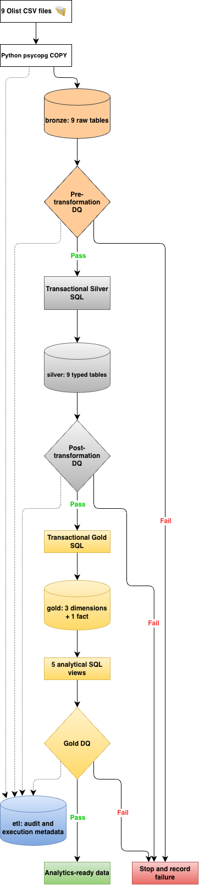

# Architecture — Olist E-commerce ELT Pipeline

## Overview

This project transforms nine Olist Brazilian E-Commerce CSV files into a PostgreSQL analytics warehouse. Python orchestrates bulk ingestion, SQL transformations, and data quality checks. The pipeline runs locally.

## Data flow

## Physical architecture

- **Source:** nine CSV files in `data/raw/` downloaded from [Olist on Kaggle](https://www.kaggle.com/datasets/olistbr/brazilian-ecommerce).
- **Runtime:** Python 3.9 virtual environment `.project1`.
- **Database:** local PostgreSQL database `ecommerce_dw`.
- **Code:** `src/` for Python and `sql/` for DDL, transformations, and assertions.
- **Logs:** `logs/` (excluded from Git).
- **Tests:** `tests/`, executed with pytest.

## Bronze layer

Nine source-aligned tables preserve incoming values primarily as text. Each row includes ingestion lineage such as `batch_id`, `source_file`, and `ingested_at`. Python uses PostgreSQL `COPY FROM STDIN` for bulk loading. `etl.ingestion_batches` records each file load's status and row count.

**Decision:** preserve source fidelity before applying type conversions. **Trade-off:** raw fields are not suitable for direct analytical calculations.

## Silver layer

Nine tables apply SQL types, primary keys, foreign keys, and validation constraints. The Silver transformation runs in one PostgreSQL transaction. Source batch identifiers and transformation timestamps provide lineage.

Pre-transformation checks cover missing customer IDs, duplicate orders, invalid item prices, invalid review scores, and orphaned order items. Post-transformation checks reconcile Bronze and Silver row counts. Check results are recorded in `etl.data_quality_runs` and `etl.data_quality_results`; selected invalid records are stored as JSONB in `etl.rejected_records`.

## Gold dimensional model

### Dimensions

| Table | Business key | Meaning |
|---|---|---|
| `gold.dim_customers` | `customer_id` | Customer record associated with an order |
| `gold.dim_products` | `product_id` | Product attributes and translated category |
| `gold.dim_sellers` | `seller_id` | Seller attributes |

Dimensions have generated surrogate keys. `customer_unique_id` supports analysis across orders from the same underlying customer; it is distinct from `customer_id`.

### Fact

`gold.fact_order_items` has the **grain of one order item**, uniquely identified by `(order_id, order_item_id)`. It references the three dimensions and stores purchase timing, order status, item price, and freight value.

**Critical modeling rule:** never join order items directly to order payments and sum prices without accounting for join fanout. Multiple items and multiple payment records for the same order can multiply rows.

### Analytical views

| View | Grain / purpose |
|---|---|
| `gold.vw_order_metrics` | One order with items; merchandise, freight, item count |
| `gold.vw_monthly_sales` | Purchase month; delivered-order sales and AOV |
| `gold.vw_category_performance` | Product category; delivered item metrics |
| `gold.vw_state_performance` | Customer state; delivered order metrics |
| `gold.vw_customer_purchase_summary` | Unique customer; delivered purchases and repeat behavior |

Delivered merchandise value is based on item prices and **is not equivalent to accounting revenue**. Distinct order counts across product categories are not additive.

## Orchestration and observability

`src/run_pipeline.py` executes seven required steps in order:

1. Bronze ingestion
2. Pre-transformation quality validation
3. Silver transformation
4. Post-transformation reconciliation
5. Gold transformation
6. Gold analytical view creation
7. Gold validation

The controller stops on the first failed step. `etl.pipeline_runs` stores overall execution state; `etl.pipeline_step_runs` stores step status, duration, exit code, and error details. Logs include the pipeline ID. Quality and ingestion audit tables use their own run identifiers.

## Transaction boundaries and idempotency

Silver and Gold transformations are individually transactional, but the **entire pipeline is not a single atomic transaction**. A later failure can leave earlier layers refreshed. Repeated successful full-refresh runs preserve business-record counts, although generated surrogate keys and audit history can change.

## Design choices and alternatives

| Decision | Why chosen | Alternative and trade-off |
|---|---|---|
| Full refresh | Static dataset; straightforward correctness | Incremental ingestion/CDC reduces repeated work but increases complexity |
| PostgreSQL SQL transformations | Data volume fits one database; transparent SQL | Spark supports distributed workloads but adds operational overhead |
| Python orchestration | Lightweight, educational, easy to inspect | Airflow adds scheduling, retries, UI, and more infrastructure |
| Standard SQL views | No refresh maintenance; always query current tables | Materialized views can improve query latency but require refresh logic |
| PostgreSQL metadata tables | Queryable operational history | Centralized telemetry platforms scale further but need setup |

## Known limitations

- No automatic scheduling, retries, or alerts.
- No incremental loading or change data capture.
- No SCD Type 2 history.
- No atomic publication across all warehouse layers.
- No heartbeat or stale-run reconciliation for interrupted processes.
- No cloud deployment or distributed tracing.